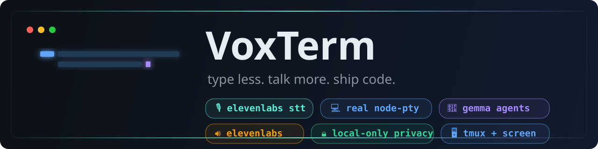

<div align="center">


# VoxTerm

**Type less. Talk more. Ship code.**

A premium, voice-ready terminal workspace for developers — real operating-system
shells, speech-to-text dictation, agent-agnostic CLI sessions and an explicit,
honest human-in-the-loop workflow.

[](./package.json)
[](./LICENSE)
[](#platform-support)
[](./tsconfig.base.json)
[](https://www.electronjs.org)
[](https://react.dev)
[](./tests)
[](https://hacktoberfest.com)



</div>

---

## Table of contents

- [Why VoxTerm](#why-voxterm)
- [Feature highlights](#feature-highlights)
- [Platform support](#platform-support)
- [Quick start](#quick-start)
- [Configuration](#configuration)
  - [Configuring from `.env`](#configuring-from-env)
  - [Configuring in the app](#configuring-in-the-app)
- [Using VoxTerm](#using-voxterm)
  - [Workspace](#workspace)
  - [Terminals](#terminals)
  - [Dictation (speech to text)](#dictation-speech-to-text)
  - [Prompt enhancement (Gemma)](#prompt-enhancement-gemma)
  - [Announcements (text to speech)](#announcements-text-to-speech)
  - [Attaching to tmux / screen sessions](#attaching-to-tmux--screen-sessions)
  - [Coding agents](#coding-agents)
  - [Activity log](#activity-log)
- [Keyboard shortcuts](#keyboard-shortcuts)
- [Settings reference](#settings-reference)
- [Security & privacy model](#security--privacy-model)
- [Architecture](#architecture)
- [Project structure](#project-structure)
- [Tech stack](#tech-stack)
- [Testing & verification](#testing--verification)
- [Known limitations](#known-limitations)
- [Roadmap](#roadmap)
- [Contributing](#contributing)
- [License](#license)
- [Author](#author)

---

## Why VoxTerm

Most "AI terminals" are a chat box bolted onto a shell, wrapped in marketing.
VoxTerm is the opposite: a genuinely good terminal first, with voice and local
models added where they actually help — and **every control either does the thing
it claims or tells you exactly why it can't.**

Concretely:

- **Real shells, not a pretend prompt.** Every tab is a genuine `node-pty`
  process (bash, zsh, fish, anything on `$PATH`) with correct input, output,
  resize, Unicode and cleanup semantics.
- **Dictation into the terminal, never autopilot.** A hotkey records your voice,
  the transcript is (optionally) cleaned up by a local model and typed into the
  active terminal — **it is never executed for you.** You still press Enter.
- **Honest providers.** Prompt enhancement runs against a real fallback chain
  (Ollama → Google hosted Gemma). Nothing is called unless a credential and a
  provider are actually configured, and local-only mode refuses every cloud
  request.
- **No fake data.** Tool detection, provider reachability, session discovery and
  system stats all reflect the machine right now — or report "not available".

---

## Feature highlights

| Feature | Status | What it really does |
| --- | :---: | --- |
| 🖥️ **Real OS terminals** | ✅ | Genuine `node-pty` sessions with input/output, resize, copy/paste, Unicode, stable session IDs and correct teardown on exit |
| 🎙️ **Speech-to-text dictation** | ✅ | Renderer microphone capture → ElevenLabs transcription → inserted into the active terminal (never auto-run) |
| 🌍 **Multilingual** | ✅ | Automatic language detection or an explicit language hint; works for English, Urdu, Hindi, Arabic, Spanish and more |
| 🤖 **Prompt enhancement** | ✅ | Provider fallback chain **Ollama → Google hosted Gemma**, with per-request timeouts and honest per-provider status |
| 🔒 **Local-only privacy** | ✅ | A single switch blocks every cloud request; pair with Ollama to keep all text on the machine |
| 🖧 **tmux / screen attach** | ✅ | Live discovery of sessions running *outside* VoxTerm, with exact `$N`-id targeting and honest shared/busy caveats |
| 🔊 **Spoken announcements** | ✅ | Real ElevenLabs text-to-speech for events VoxTerm can genuinely confirm (errors, session exits, agent events) |
| 🧩 **Agent agnostic** | ✅ | OpenCode, Claude Code, Codex CLI, Gemini CLI, Aider — plain installed-binary detection, nothing fabricated |
| 🎨 **A terminal you can live in** | ✅ | 16 curated monospace families, two dark themes, cursor/line-height/density controls, reduced-motion support |
| 📊 **Truthful diagnostics** | ✅ | Workspace reports the real Electron/Node/platform/host/shell/tool versions; Activity records only safe metadata |

> **Design rule:** if a feature isn't wired up, it is disabled and labelled
> honestly — never a dead button, placeholder session, or invented statistic.

---

## Platform support

VoxTerm is **built and verified on Linux** (developed on Kali, tested headless
under Xvfb). The application code is written to be cross-platform and degrades
gracefully, but only Linux packaging targets are configured today
(`AppImage` + `deb` via electron-builder).

| Capability | Linux | macOS | Windows |
| --- | :-: | :-: | :-: |
| typecheck · lint · 105 tests · build | ✅ | ⬜ needs a runner | ⬜ needs a runner |
| UI smoke test (real Electron + CDP) | ✅ | ⬜ | ⬜ |
| `node-pty` rebuild + shell adapters | ✅ | ⬜ | ⬜ |
| Global voice hotkey (`uiohook-napi`) | ✅ X11 / ⚠️ Wayland* | ⬜ | ⬜ |

\* On Wayland the global hook is unavailable, so VoxTerm falls back to an
in-window hotkey and says so in the UI. X11 is fully supported.

---

## Quick start

### Requirements

- **Node.js 20+** (developed on Node 22) and npm
- A **C/C++ toolchain** for the `node-pty` native build (`build-essential`,
  `python3` on Debian/Kali)
- Optional: **Ollama** for fully-local prompt enhancement, **tmux**/**screen**
  for external-session attach, **ffmpeg** only if you experiment with audio
  tooling

### Install & run

```bash
git clone https://github.com/maisamabbas0323/voxterm.git
cd voxterm

npm install            # installs deps and rebuilds node-pty for Electron
cp .env.example .env   # optional: credentials (see Configuration)

npm run dev            # launch in development
```

### Build & package

```bash
npm run build          # typecheck + production build into out/
npm run package        # AppImage + deb via electron-builder (into release/)
npm run package:dir    # unpacked directory build (faster)
npm start              # preview the production build
```

### All scripts

| Script | Purpose |
| --- | --- |
| `npm run dev` | Development app with HMR (`electron-vite dev`) |
| `npm run dev:watch` | Same, with watch mode |
| `npm run build` | `typecheck` + production bundle into `out/` |
| `npm start` | Preview the built app (`electron-vite preview`) |
| `npm run package` / `package:dir` | Package Linux installers / unpacked build |
| `npm run typecheck` | Strict TypeScript check for main/preload **and** renderer |
| `npm run lint` | ESLint over all `.ts`/`.tsx` |
| `npm test` | Vitest unit suite (105 tests) |
| `npm run test:watch` | Vitest watch mode |
| `npm run verify:ui` | Headless Electron + CDP smoke test (27 checks) |
| `npm run rebuild` | Rebuild `node-pty` for the current Electron |

---

## Configuration

There are two ways to configure VoxTerm, and they compose: a value you set in
the app **always wins** over the environment.

### Configuring from `.env`

Copy `.env.example` to `.env` in the project root (or next to the packaged app).
VoxTerm loads it at startup in the **main process only**, and treats the
credentials as already configured — no need to paste them into the GUI.

```bash
# --- Credentials (main process only; never sent to the renderer) -------------
VOXTERM_GOOGLE_API_KEY=...        # hosted Gemma prompt enhancement
VOXTERM_ELEVENLABS_API_KEY=...    # speech-to-text + spoken announcements

# --- Optional non-secret defaults (applied only when the setting is untouched) -
VOXTERM_GOOGLE_MODEL=             # default: gemma-4-31b-it
VOXTERM_ELEVENLABS_VOICE_ID=      # announcement voice
VOXTERM_ELEVENLABS_MODEL=         # default: eleven_multilingual_v2

# Runtime (rarely needed)
VOXTERM_DISABLE_CHROMIUM_SANDBOX= # 1 only in containers/CI
```

Recognised aliases: `GOOGLE_API_KEY` / `GEMINI_API_KEY` and
`ELEVENLABS_API_KEY`. A variable already exported in the real environment is
never overridden by the file. `.env` is git-ignored; only `.env.example` is
tracked. Secret values are read in the main process only and are never sent to
the renderer or written to logs.

### Configuring in the app

All of the above is also available in **Settings**, grouped by section, and
secrets are stored via Electron's `safeStorage` in `secrets.json` under your
user-data directory (`~/.config/voxterm/` on Linux). A credential you type in
the app takes precedence over the environment so you can always override `.env`
without editing it.

---

## Using VoxTerm

VoxTerm has a compact icon rail with four views. The current view's name sits in
the title bar.

### Workspace

The landing dashboard shows a **real** snapshot of your environment, assembled
at runtime:

- **Coding agents** — which of the built-in CLI agents are actually installed,
  with resolved path and version (and an honest "Not installed" otherwise).
- **System** — VoxTerm, Electron, Node and platform versions; hostname; the
  resolved default shell.
- **Recent activity** — the latest safe metadata events.
- **Detected tooling** — bash/zsh/sh/fish, tmux and screen availability, plus
  `node-pty` status.

Nothing here is mocked: every value comes from the running machine.

### Terminals

The heart of the app.

- One tab per `node-pty` session, each with a real shell, correct resize and
  **persistent scrollback** that survives tab switches (xterm instances are
  cached by session ID, not index).
- Create terminals (`Ctrl+Shift+T`), rename them, close them (with an optional
  confirm), and open a new terminal in the **same working directory** as the
  active one.
- Toolbar actions: find in scrollback, scroll to bottom, clear, copy the
  working directory.
- Font zoom scoped to the terminal only (`Ctrl+=` / `Ctrl+-` / `Ctrl+0`).
- A compact **external session strip** appears under the tabs when tmux/screen
  sessions exist (see below).

### Dictation (speech to text)

Voice is **off by default**; enable it in **Settings → Voice**, then add an
ElevenLabs key (**Settings → System & credentials**, or via `.env`).

1. Focus the **Terminals** view.
2. Hold the push-to-talk hotkey (default `Ctrl+Alt+Space`) and speak.
3. Release. VoxTerm captures 16 kHz mono audio, sends it to ElevenLabs for
   transcription, optionally rewrites it with Gemma, and **types the result into
   the active terminal**.

The transcript is **never executed automatically** — you review it and press
Enter yourself. If auto-insert is off (or no terminal is active), the text goes
to the clipboard so nothing is lost. By default the hotkey is honoured **only on
the Terminals view**, so a stray keypress can never open the microphone
elsewhere. Transcript text is never written to the activity log.

> ⚠️ **Scope requirement:** the ElevenLabs key must have the `speech_to_text`
> permission enabled. A key limited to text-to-speech will be refused with a
> clear message.

### Prompt enhancement (Gemma)

Dictation can be cleaned up before it lands in the shell, and any text can be
enhanced on demand. Providers are tried in order until one answers:

1. **Ollama** — your local model server (`http://127.0.0.1:11434` by default).
   Nothing leaves the machine. Leave the model blank to use the first installed
   Gemma model.
2. **Google AI Studio** — hosted Gemma via the Gemini API, reached with your API
   key against the **official endpoint** (there is deliberately no base-URL
   field to misconfigure). Default model `gemma-4-31b-it`.

Provider priority, per-provider enable/model, request timeout and **local-only
mode** are configured in **Settings → Prompt providers**. Local-only mode refuses
*every* cloud request even if a cloud provider is enabled.

### Announcements (text to speech)

Optional spoken notifications, synthesised by ElevenLabs and played locally.
Only events VoxTerm can genuinely confirm are offered: **errors**, **session
exits** (skipped when you only detached) and **agent events**. Choose a voice,
model, volume and rate, and pick which categories may be spoken. Announcement
activity itself is never announced, and terminal contents/secrets are never read
aloud.

### Attaching to tmux / screen sessions

While the **Terminals** view is open, VoxTerm polls for sessions running
*outside* the app and lists the attachable ones in a strip directly under the
tabs — no dialog, one click to attach.

- Attaching uses the multiplexer's **exact identifier**: tmux sessions are
  targeted by their stable `$N` session id (so names containing `.` or `:` still
  work), and screen by `pid.name`.
- VoxTerm **never terminates or steals** a session it didn't create. If another
  client is attached to a screen session, VoxTerm joins in shared mode rather
  than disconnecting it.
- Closing an attached tab **detaches**; it does not kill the underlying session.
- Discovery is opt-in per multiplexer and can require confirmation, in
  **Settings → External sessions**.

### Coding agents

VoxTerm ships suggestions for **OpenCode**, **Claude Code**, **Codex CLI**,
**Gemini CLI** and **Aider**, and you can add **custom agent profiles** (a single
executable token plus arguments — never a shell pipeline, and validated so user
input can never become shell syntax). Launching an agent simply types its
command into the shell; VoxTerm does not fabricate agent-specific magic.

### Activity log

A bounded, non-sensitive audit trail of what happened: terminal lifecycle,
voice outcomes, prompt-provider calls, announcements and errors. It stores
**metadata only** — never terminal output, never environment variables, never
secrets. Retention is bounded and it can be cleared from the Activity view.

---

## Keyboard shortcuts

Application-level shortcuts are handled in the capture phase and consumed, so
they never also type a control character into the focused shell.

| Shortcut | Action |
| --- | --- |
| `Ctrl+Shift+T` | New terminal |
| `Ctrl+Shift+W` | Close the active terminal |
| `Ctrl+Tab` / `Ctrl+Shift+Tab` | Cycle through terminals |
| `Ctrl+1` … `Ctrl+8` | Jump to terminal *N* |
| `Ctrl+9` | Jump to the last terminal |
| `Ctrl+F` | Find in the active terminal (**Terminals view only**) |
| `Ctrl+=` / `Ctrl++` | Zoom terminal font in |
| `Ctrl+-` | Zoom terminal font out |
| `Ctrl+0` | Reset terminal font zoom |
| `Ctrl+Alt+Space` | Push-to-talk (configurable in Settings → Voice) |

Find is deliberately scoped to the Terminals view and is never consumed on any
other page, so it can't hijack search from the surrounding interface.

---

## Settings reference

Settings are validated with Zod and persisted to
`~/.config/voxterm/settings.json` (atomic writes, owner-only permissions).
Recovery is **section-scoped**: a single bad value resets only its own section,
never the whole file. Sections:

### Appearance
Theme (VoxTerm / VoxTerm contrast), terminal font family (16 curated stacks),
font size, line height, cursor style & blink, interface density, animation
intensity and reduce-motion.

### Terminal
Default shell (blank = auto-detect from `$SHELL`), startup directory, scrollback
size, confirm-before-terminate and before-app-close, new-terminal behaviour
(home / active-session cwd / configured), copy-on-select, right-click paste,
link detection and font ligatures.

### Voice
Enable voice input, terminal-only mode, auto-enhance with Gemma, auto-insert,
push-to-talk hotkey, hold-to-talk vs toggle, ElevenLabs speech-to-text model
(`scribe_v1`), language (`auto` or an ISO-639 code) and minimum recording length.

### Prompt providers
Provider priority (first/second), Ollama enable/base-URL/model, Google enable and
model, local-only mode, review-before-send, project-context toggle, request
timeout, plus a **live provider status** table that probes the real endpoints and
your stored credentials.

### Announcements
Enable, mute, voice ID, TTS model, volume, rate and which event categories are
spoken.

### External sessions
Discover tmux, discover screen, and confirm-before-attach.

### Privacy
Local-only mode, diagnostic logging, log redaction, whether to log terminal
output, session cleanup on exit (terminate / ask / keep managed sessions) and
activity retention count.

### System & credentials
Credential status for **Google** and **ElevenLabs** (presence only — values are
never shown to the renderer), plus open-external and reveal-in-folder helpers.

---

## Security & privacy model

- **Context isolation on, Node integration off.** The renderer is sandboxed and
  reaches the system only through a typed, narrow `contextBridge`
  (`window.voxterm`) — no Node primitives leak into the page.
- **Every IPC payload is Zod-validated** in the main process; a malformed
  request is rejected rather than acted on. Channels are declared once in
  `src/shared/ipc.ts` and shared by main, preload and renderer.
- **PTYs never live in the renderer.** All process ownership stays in main; the
  renderer only sends input/resize and receives data.
- **Secrets stay in main.** Credentials live in `secrets.json` (via
  `safeStorage`) or in `.env`; only their *presence* crosses IPC. They are
  scrubbed from provider error messages, never logged and never serialised to the
  renderer.
- **Local-only mode** blocks every cloud call at the service layer, before any
  network request is made.
- **Log redaction** and safe activity metadata: no terminal output, no env vars,
  no secrets.
- **Terminal insertion never executes.** Dictation and enhancements paste text;
  running it is always your explicit Enter.

---

## Architecture

VoxTerm is a three-process Electron application with a strict boundary between
process ownership and presentation.

```
┌────────────────────────────────────────────────────────────────────────────┐
│  Main process (Node)                                                         │
│    index.ts      .env loading, wiring, lifecycle                             │
│    window.ts     BrowserWindow creation, navigation hardening, CSP           │
│    settings/     SettingsStore + JsonStore (atomic, owner-only) + .env        │
│    activity/     ActivityLog (bounded, non-sensitive events)                  │
│    terminals/    TerminalSessionManager (owns every node-pty instance)        │
│    agents/       AgentProfileStore + real executable detection                │
│    prompts/      provider fallback chain (Ollama → Google), instructions      │
│    voice/        ElevenLabs STT + global hotkey + recording state machine     │
│    announcements/ElevenLabs TTS for confirmed events                          │
│    external/     tmux / screen discovery + attach targeting                   │
│    system/       SystemInfo aggregation (versions, tools, STT readiness)      │
│    ipc/          one handler module per domain; every payload Zod-validated   │
└───────────────────────────────────────┬──────────────────────────────────────┘
              contextBridge (typed, narrow) │ ipcRenderer.invoke / .on
┌───────────────────────────────────────┴──────────────────────────────────────┐
│  Preload (src/preload/index.ts)   exposes window.voxterm only — no Node       │
├───────────────────────────────────────────────────────────────────────────────┤
│  Renderer (React, sandboxed, contextIsolated)                                 │
│    state/store.tsx        app store: settings, sessions, agents, activity…    │
│    features/terminals/    xterm controller registry + tabs + external strip   │
│    features/voice/        microphone capture + recording pipeline             │
│    components/            TitleBar · Sidebar · Logo · Modal · Toasts · …      │
│    pages/                 Workspace · Terminals · Activity · Settings         │
└───────────────────────────────────────────────────────────────────────────────┘
```

**PTYs never live in the renderer.** The renderer sends input/resize and receives
data over IPC; process ownership stays entirely in main. This is both a security
and a correctness requirement. **xterm instances are cached by session ID**, so
scrollback is never lost on tab switches (even across React StrictMode
remounts).

The shared layer (`src/shared/**`) contains the Zod schemas and the IPC contract
— the single source of truth for both sides — and never imports `node:*` or
`electron` because it is bundled into the renderer.

---

## Project structure

```
voxterm/
├── src/
│   ├── main/                     Electron main process
│   │   ├── index.ts              entry: loads .env, wires services, creates window
│   │   ├── window.ts             BrowserWindow, CSP, navigation hardening
│   │   ├── services.ts           service container + broadcast helpers
│   │   ├── activity/             bounded activity log
│   │   ├── agents/               agent profiles + real executable detection
│   │   ├── announcements/        ElevenLabs TTS orchestration
│   │   ├── external/             tmux / screen discovery + attach targets
│   │   ├── ipc/                  one Zod-validated handler module per domain
│   │   ├── prompts/              provider chain (ollama, google) + instructions
│   │   ├── settings/             settings store, secrets, .env loader
│   │   ├── system/               SystemInfo aggregation
│   │   ├── terminals/            node-pty SessionManager + shell resolution
│   │   ├── util/                 exec, json store, logger
│   │   └── voice/                ElevenLabs STT, hotkey, VoiceController
│   ├── preload/index.ts          typed contextBridge (window.voxterm)
│   ├── renderer/                 React 19 + xterm.js UI
│   │   ├── index.html
│   │   └── src/
│   │       ├── App.tsx           shell, nav, global shortcuts
│   │       ├── components/       TitleBar, Sidebar, Logo, Modal, Toasts…
│   │       ├── features/         terminals (registry/tabs/surface/external), voice
│   │       ├── lib/              fonts, icons, formatting, workspace helpers
│   │       ├── pages/            Workspace, Terminals, Activity, Settings
│   │       ├── state/            app store (reducer + actions + effects)
│   │       └── styles/           tokens.css + global.css
│   └── shared/                   schemas.ts, ipc.ts, types.ts, agents.ts, api.ts
├── assets/brand/                 hand-built SVG marks + PNG favicons
├── docs/                         logo.svg, banner.svg
├── resources/icon.png            app icon used by electron-builder
├── scripts/                      verify-{ui,pty,env,workspace,tooltip}, asset build
├── tests/                        Vitest suites (8 files, 105 tests)
├── electron-builder.yml          packaging config (AppImage + deb)
├── electron.vite.config.ts       build config for main/preload/renderer
├── vitest.config.ts              unit-test config
├── tsconfig.*.json               strict TS configs (node, web, base)
└── agent.md / progress.md        architecture notes & honest status log
```

---

## Tech stack

| Layer | Choice |
| --- | --- |
| Runtime | Electron 44 (context-isolated, sandboxed renderer) |
| Language | TypeScript (strict) across main, preload, renderer, shared |
| UI | React 19 + a hand-rolled design-token system (no CSS framework) |
| Terminal | [`@xterm/xterm`](https://xtermjs.org) 6 with fit / search / web-links / WebGL addons |
| PTY | `node-pty` (native, rebuilt for Electron) |
| Validation | [Zod](https://zod.dev) 4 — settings, IPC payloads, agent profiles |
| Build | `electron-vite` (Vite 7) + `electron-builder` |
| Tests | [Vitest](https://vitest.dev) 5 + a headless Chrome DevTools Protocol smoke test |
| Icons | [lucide-react](https://lucide.dev) (SVG only) |
| Hotkey | `uiohook-napi` with an Electron `globalShortcut` fallback |
| Speech | ElevenLabs (speech-to-text + text-to-speech) |
| Local models | Ollama; hosted Gemma via Google AI Studio |

---

## Testing & verification

VoxTerm is verified at three levels. All commands run from the repo root.

```bash
npm run typecheck   # strict TS for main/preload and renderer
npm run lint        # ESLint (0 errors)
npm test            # 105 unit tests across 8 files
npm run build       # production bundle
npm run verify:ui   # 27 runtime checks against the built app (Xvfb on Linux)
```

**Unit tests** (`tests/`) cover settings parsing & section-scoped recovery, IPC
payload validation, the prompt-provider chain (ordering, fallback, missing
credentials, secret redaction, local-only gating), the ElevenLabs STT client
(including key scrubbing and timeouts), `.env` parsing & secret mapping,
tmux/screen parsing and attach targeting, and announcement routing.

**Runtime UI smoke test** (`scripts/verify-ui.cjs`) boots the real built app
under Xvfb, drives it over the Chrome DevTools Protocol and asserts the things
you can only see at runtime — collapsed-rail icons, the brand mark, a real xterm
surface mounting, presence of the attach/find controls, the font dropdown
resolving, and zero horizontal overflow at both desktop and narrow widths.

Additional manual harnesses: `scripts/verify-pty.cjs` (spawns a real PTY and
waits for its marker), `scripts/verify-env.cjs` (prints a JSON snapshot of the
environment), `scripts/verify-workspace.cjs` and `scripts/verify-tooltip.cjs`.

### Status

| Check | Result |
| --- | --- |
| `npm run typecheck` | ✅ pass (node + web) |
| `npm run lint` | ✅ 0 errors (3 pre-existing `react-refresh` warnings) |
| `npm test` | ✅ 105 / 105 |
| `npm run build` | ✅ |
| `npm run verify:ui` | ✅ 27 / 27 |
| Real provider calls | ✅ Google Gemma verified; ✅ ElevenLabs TTS verified |

Honest details live in [`progress.md`](./progress.md).

---

## Known limitations

- **Dictation needs an ElevenLabs key *with the `speech_to_text` scope*.** With
  no key the UI says so and refuses to record; a TTS-only key is refused by the
  API with a clear message. There is no offline transcription path.
- **Prompt enhancement needs a provider.** Ollama fails fast with a clear message
  if nothing is listening at its base URL; Google needs a key and honours
  local-only mode.
- **External sessions are attach-only.** VoxTerm never terminates a session it
  did not create, and closing an attached tab only detaches.
- **Linux-only packaging today** (AppImage + deb). macOS/Windows are unverified
  and have no build targets configured.
- **Wayland** lacks the global hotkey hook; VoxTerm falls back to an in-window
  key and labels it honestly.
- `npm audit` reports a handful of moderate advisories in the dev toolchain;
  none affect the shipped runtime.

---

## Roadmap

- Per-agent adapters enabling prompt injection and structured agent events.
- Speaker diarization and word-timestamp highlighting in the dictation flow.
- More TTS / announcement providers.
- macOS and Windows verification runners and packaging targets.
- A keyboard-only, screen-reader-friendly dictation review flow.

---

## Contributing

This repository is **hackathon-first and issues-first** (Hacktoberfest 2026,
Week 2). Good first contributions:

- Windows/macOS verification coverage (needs real runners or hardware)
- Additional TTS or speech-to-text providers behind the same honest interfaces
- Accessibility improvements to the dictation and settings flows
- Documentation and example `.env` recipes (never commit real keys)

Please keep changes **honest, tested and scoped**: run
`npm run typecheck && npm run lint && npm test && npm run build` before opening a
PR, and never add placeholder UI or fabricated data. Look for `good first issue`
labels to get started.

---

## License

[MIT](./LICENSE) © 2026 Maisam Abbas

---

<div align="center"><sub><em>VoxTerm — where the prompt speaks before you type.</em></sub></div>
